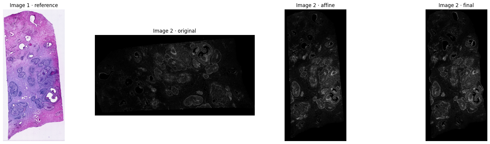

# MorphAlign

**Explore globally. Align locally.** A training-free Python workflow for registering two microscopy images without assuming their stain, modality, or number of channels.

- **Image 1** is fixed/reference. **Image 2** is moving.
- Each input can be a **grayscale** `(H, W)` or **multichannel** `(H, W, C)` array; channel counts can differ.
- Estimation uses channel-agnostic image structural features, Sobol global affine search, multi-resolution Adam, and optional smooth deformable refinement.
- The **same spatial mapping** is applied to every original channel of image 2; output dimensions follow image 1 and original moving dtype is preserved.
- We include two **real microscopy examples** at `examples/image1.tiff` and `examples/image2.tiff`, downsampled from the user-provided H&E and DAPI TIFFs. File names and registration API do not encode their modalities. These are examples, **not registered ground truth**, and should not be published without appropriate image-sharing authorization.



*Example of MorphAlign registration showing the reference image,
moving image, and registration results using global affine alignment
and optional deformable refinement.*


## Start the interactive web demo

```bash
python -m pip install -e '.[app,notebook,test]'
python app.py
```

The Gradio application opens locally. The two image inputs are pre-filled with `examples/image1.tiff` and `examples/image2.tiff`; upload your own TIFF/PNG/JPEG instead. Select the channels used for feature *estimation*, or leave `auto`. Enable/disable deformation; view before/after images and download `results.zip` containing the native registered TIFF and matrices.

## Quick Python usage

```python
from morphalign import read_image, register, export_result

image1 = read_image('examples/image1.tiff')
image2 = read_image('examples/image2.tiff')

result = register(image1, image2, channels='auto', deformable=True)
export_result(result, image1, image2, 'outputs')
```

The registered array is `result['registered']`. The affine matrix `result['affine']['matrix_he_to_af']` (legacy internal key) maps **image1/reference pixel coordinates → image2/moving pixel coordinates**. The exported alias `image1_to_image2_affine.npy` uses generic naming. Deformation is represented by a displacement field in image1 coordinates; the inverse affine alone is not the complete inverse nonlinear transform.

## Interactive notebook

Open `demo.ipynb` from the repository root. It loads `image1.tiff` and `image2.tiff` by default; edit the two path variables to use your images. Controls allow choosing alignment channel indices, exploration budget, and optional deformation. No fixed number of channels and no stain-specific mode is selected.

## Formats, assumptions, limitations

| Item | Behavior |
| --- | --- |
| Grayscale input | `(H, W)` |
| Multichannel input | `(H, W, C)`; channel-last |
| RGB | Treated as 3 optical color channels, not 3 molecular markers |
| Moving image channel selection | `auto` or explicit 0-based indices; **all** moving channels retained in registered output |
| Registered output | TIFF, reference spatial size, original moving dtype and channels |
| Transform | 5-DOF affine, optional regularized displacement field (no affine shear yet) |
| Image sizes | Different sizes and aspect ratios supported |
| Whole slide | Not yet tiled/pyramidal; crop to matched tissue areas before loading |
| Extra axes (T, Z) | Select a 2D image first; do not pass whole 5D stacks |

Generic structural edges can fail when two imaging modalities highlight entirely different structures. Use manual QC and independently matched landmarks to assess accuracy; optimized feature correlation is *not* target registration error. Affine alignment cannot recover tissue cropped from the source or physical structures absent from one acquisition.

## Tests

```bash
pytest -q
```

## Repository status

This ZIP is prepared for GitHub but is **not a published GitHub repository**. We have not pushed to your GitHub account. The example data contain real imagery furnished for this demonstration; confirm that you have rights to publish those images before making the repository public.

## License

MIT for source code; the example images are **not** licensed for redistribution under MIT by default. Image reuse requires appropriate permission.
